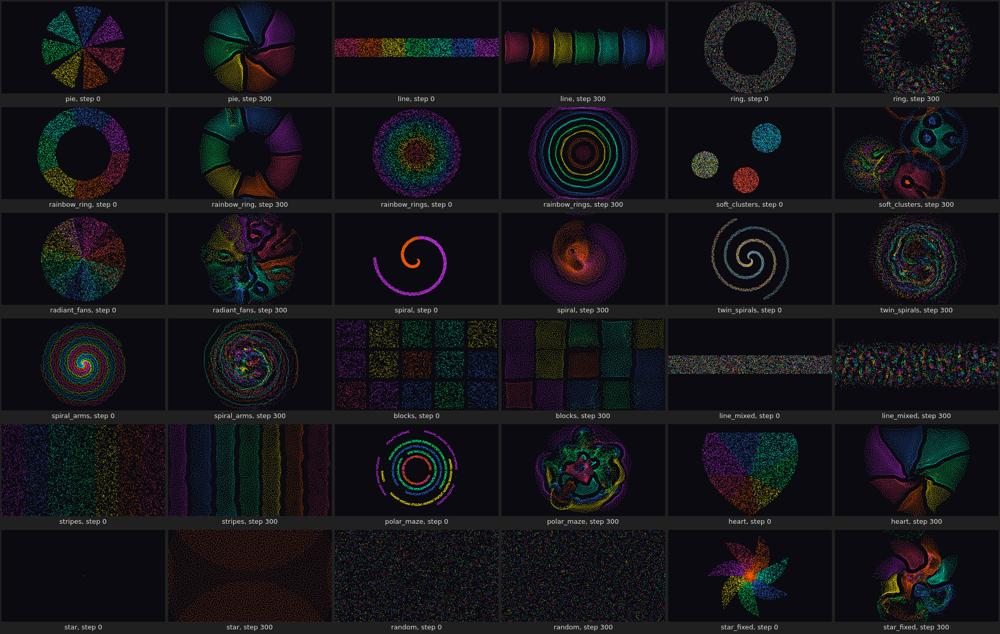
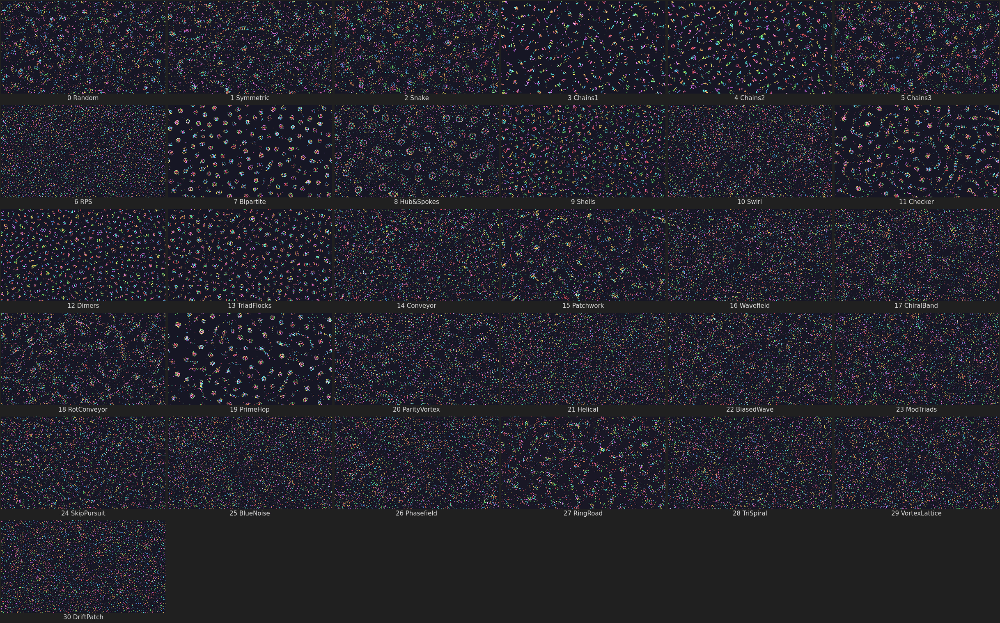
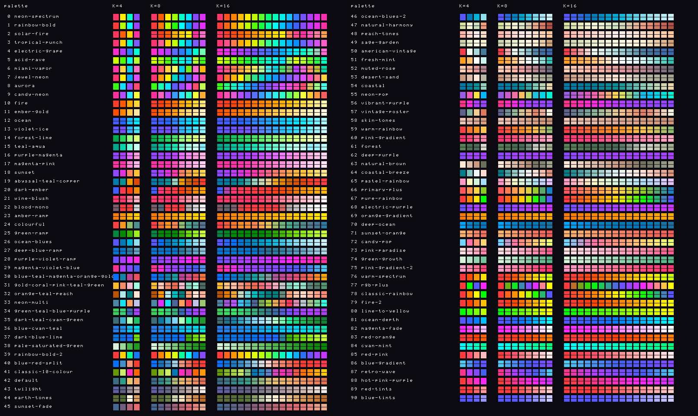
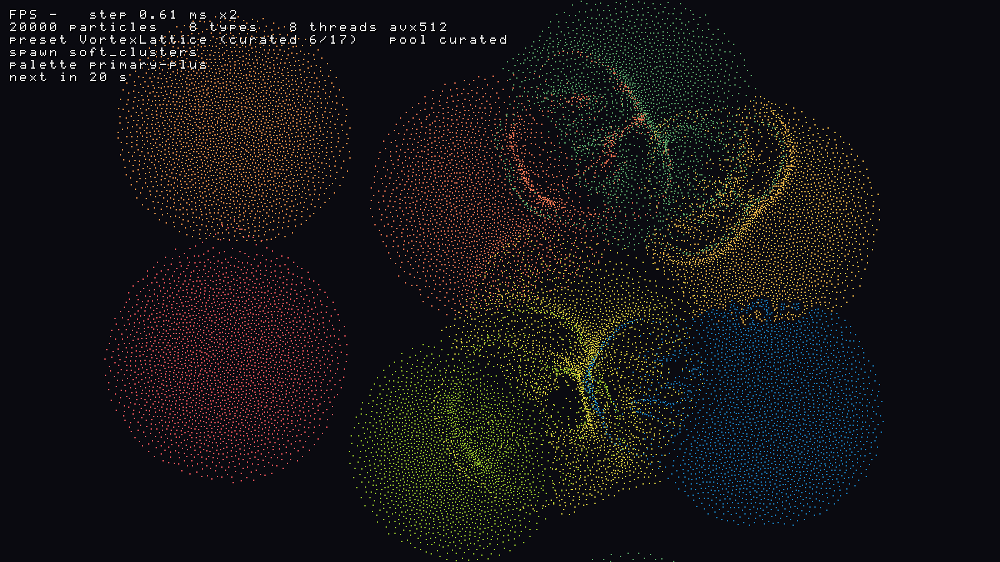

# Particle Life in assembly (x86-64 and AArch64)

A Particle Life simulation whose whole program is hand-written x86-64
assembly (GNU `as`, `.intel_syntax noprefix`, ~8 600 lines): simulation
core, spawn layouts, rule presets, palettes, software renderer with a text
overlay, SDL2 window loop, argument parsing and benchmark. C appears only in
the reference implementation, the test harnesses and one contact-sheet
helper. A port of all of it to AArch64 / NEON for the Raspberry Pi 4 lives
in `src/arm64/` (see [ARM64](#arm64-raspberry-pi-4)); it builds, runs and
passes nearly all tests on a real Pi 4B (one scene exceeds the reference
tolerance, see [What was verified](#what-was-verified-on-arm64)).

## At a glance

| | x86-64 (Ryzen 7 255) | AArch64 (Raspberry Pi 4B) |
|---|---|---|
| code | `src/*.S`, AVX2 / AVX-512 | `src/arm64/*.S`, NEON |
| 1 thread, ns per particle-step | 62 | 1 720 |
| all cores, ns per particle-step | 9 to 10 (8 threads) | 450 to 550 (4 threads) |
| vs the C reference, 1 thread | 4 to 11× faster | 1.9× faster |

Both builds share the C reference (`ref/`), the test suites (`tests/`) and
the font and palette data. `make test` runs the same suites against either.

Contents: [Build and run](#build-and-run) · [Scenes](#scenes) ·
[Algorithm](#algorithm) · [Correctness](#correctness) ·
[Performance](#performance) · [ARM64](#arm64-raspberry-pi-4) ·
[Raspberry Pi guide](docs/PI.md) · [Limitations](#not-done--limitations)

Both architectures are in one repository: `main` carries everything
(x86-64, AArch64 and the shared parts).

Every 2 minutes the window shows a new **scene**:

- a **preset**: one of pl-box's 17 curated configurations (rule generator,
  type count and tuned physics), or one of the 31 generated rule presets;
- its **type count**: the curated preset's own, or drawn from 2..16;
- a **spawn layout**: pl-box's starting patterns (pie, rings, spirals, soft
  clusters, blocks, stripes, polar maze, heart, ...), chosen with pl-box's
  weights;
- a **palette**: one of 91 named palettes from pl-box and biome.

An overlay in the top-left corner shows FPS, step time, particle and type
counts, preset, spawn layout, palette and the seconds to the next switch.



*Every spawn layout at step 0 and after 300 steps (curated SkipPursuit,
K = 7, 6000 particles, 800×450, palette neon-spectrum, seed 3;
`tools/spawn_sheet.sh`).*

The model follows `~/code/pl-box` (`rules.rs`, `simulation.rs`): N
particles of K types, `attraction[i][j]` ∈ [-1, 1], per-pair min and max
radius, force scale, core repulsion, friction, dt = 1/60, toroidal world,
semi-implicit Euler:

```
d >= maxr          : 0
d <  minr          : -core * (1 - d/minr)                    (hard-core repulsion)
minr <= d < maxr   : attraction * smoothstep(1 - (d-minr)/(maxr-minr))
v = v*(1 - friction*dt) + F*dt ;  p = wrap(p + v*dt)
```

pl-box's profile is the smoothstep-shaped bump, not the textbook triangle.
It is reproduced exactly: the O(N²) test reference below is a line-by-line
transcription of pl-box's loop.

## Build and run

Needs `gcc`/`as`/`ld`, libSDL2, and a CPU with AVX2 + FMA (AVX-512F is used
when CPUID and XGETBV report it).

```sh
make                 # build/particle_life and build/ref_bench
make run             # window, 20k particles, 1600x900, new scene every 2 minutes
make run ARGS="--interval 5 --pool all"
make test            # spawns and presets vs pl-box, asm vs C reference, overlay, cycling
make bench           # headless, 10k/50k/200k particles, 1 and 8 threads
make check-arm64     # assemble + symbol-check the AArch64 port with clang (see ARM64)
make bench-ref       # C reference, gcc -O3 -march=native
make bench-ref-clang # C reference, clang -O3 -ffast-math -march=native
```

```
particle_life [--particles N] [--seed S] [--width W] [--height H]
              [--types K]              pin the type count (1-16); default: per preset
              [--pool curated|generated|all]   which presets cycle (default curated)
              [--preset NAME]          start on this preset (case-insensitive; c:NAME /
                                       g:NAME pick the curated / generated one)
              [--spawn NAME]           pin the spawn layout (default: pl-box's weighted pick)
              [--palette NAME]         pin the palette (default: a pick per switch)
              [--interval SECONDS]     auto-cycle period, default 120 (2 minutes), fractions allowed, 0 = off
              [--mutate SECONDS]       every N seconds (default 20, 0 = off) re-draw 1 or 2 values of the
                                       attraction matrix; the scene, spawn and palette stay;
                                       runs with auto-cycle (off with --no-cycle, --interval 0 or C)
              [--no-cycle]             stay on the start preset
              [--list-presets] [--list-spawns] [--list-palettes]
              [--threads T] [--simd avx2|avx512] [--cell-div 1|2]
              [--steps-per-frame S] [--no-vsync]
              [--bench STEPS [--warmup STEPS]]          headless step benchmark
              [--bench-render FRAMES]                   renderer and overlay timing
              [--dump-frame out.ppm [--steps STEPS] [--overlay]]   headless, one frame
              [--headless FRAMES [--fake-clock DT]]     window frame loop without a window
              [--log-switches]                          print a line per switch
              [--keys STR]                              feed key presses to the key handler first
```

| key | action |
|---|---|
| Right / Left | next / previous preset of the pool (wrapping) |
| P | next pool (curated → generated → all), and a preset from it |
| R | re-roll: same preset and type count, new matrix draws, spawn and palette |
| S / Shift+S | next / previous spawn layout, applied at once (respawn) |
| N | respawn in the current layout |
| K | next palette that qualifies for the current type count |
| `[` / `]` | one type fewer / more (re-applies the preset, same spawn layout) |
| 1–9 | that many types |
| `+` / `-` | particle count ×5/4 / ×4/5 (respawn, same layout) |
| C | auto-cycle on/off |
| F | overlay on/off (default on) |
| Space | next scene now (a new preset, spawn and palette, as the timer would pick; restarts the countdown) |
| Z / Return | pause (also holds the countdown) |
| Esc | quit |

`[`, `]`, 1–9 and S change the current scene only: the next automatic
switch picks the preset's own type count and a spawn layout again, unless
`--types` / `--spawn` pin them. In `--keys`, `>`/`<` stand for Right/Left
and `S` for Shift+S.

The window title carries the same information as the overlay, e.g.

```
Particle Life (asm) | VortexLattice (curated 6/17) | next in 3 s | 20000 particles, 8 types | 120 fps | step 0.70 ms | spawn soft_clusters | palette primary-plus
```

Without `--seed` the window seeds from the clock, so each run starts on a
different scene. `--bench` (and `--dump-frame` without `--preset`) use
plain random rules with a uniform scatter as before, so benchmark numbers
stay comparable. The world is the window size, drawn 1:1. The window uses
half the logical CPUs; bench and dump use 1 thread unless `--threads` is
given.

## Scenes



*The 17 curated presets as the window shows them (own type count, spawn
layout from pl-box's weighted chooser, palette pick, whatever seed
`idx + 1` gives), then generated presets at K = 3, 5, 12, 16, 4, 10, 14
with chosen palettes; 600 steps each, 6000 particles, 800×450
(`tools/contact_sheet.sh`).*

### Presets

`src/presets.S` numbers 48 entries. 0–16 are pl-box's `CURATED` list
(`crates/pl-core/src/presets.rs`) in its order. 17–47 are the 31
`RulePreset` generators of `rules.rs`:

| family | curated presets | K | force | friction | core | min r | max r |
|---|---|--:|--:|--:|--:|---|---|
| `cfg` | SkipPursuit, Conveyor, Shells, Hub&Spokes | 7 | 1.1 | 0.6 | 0.7 | 12–22 | 28–45 |
| `cfg` | ParityVortex, Random, Dimers, Bipartite | 8 | 1.1 | 0.6 | 0.7 | 12–22 | 28–45 |
| `cfg` | TriadFlocks | 9 | 1.1 | 0.6 | 0.7 | 12–22 | 28–45 |
| `cfg_fric` | VortexLattice / DriftPatch | 8 | 1.1 | 0.4 / 0.5 | 0.7 | 12–22 | 28–45 |
| `flow` | Swirl, ChiralBand, Wavefield, Phasefield, TriSpiral, ModTriads | 8 | 1.4 | 0.35 | 0.9 | 12–20 | 28–45 |

The generated entries keep the per-rule physics of the previous round: the
17 rules that pl-box curates use their curated physics, the other 14 use
pl-box's `render.rs` defaults (force 0.3, friction 0.4, core 0.6, min r
12–24, max r 33–70). Their type count is drawn uniformly from 2..16 at each
switch. `--list-presets` prints all 48 with type count and physics.

The rule generators are the ones of the previous round, bit-identical to
pl-box's `RuleMatrix::from_preset` for all 29 deterministic generators and
K = 1..16 (`tests/plbox_ref.txt`). pl-box's Helical and SkipPursuit leave
[-1, 1]; installed values are clamped, as pl-box's own `jitter_attraction`
clamps.

**Pools.** `--pool` (and P) chooses which entries the timer cycles through:
`curated` (default, the tuned ones), `generated` or `all`. The next preset
comes from a shuffle bag over the pool: uniformly among the entries not yet
shown in this round, never the current one. When the pool is exhausted, a
new round starts with only the current entry marked.

### Type counts

A curated preset brings its own K (7, 8 or 9). A generated preset draws K
from 2..16. `--types K` pins K for every switch. `[`, `]` and 1–9 re-apply
the current preset with another K and respawn it in the same layout.

Everything derived from K is rebuilt on every change: the K×K matrix and
radii (entries outside K×K zeroed), the kernel tables, max radius, grid and
neighbour ranges, the force kernel (AVX2 K≤8, AVX2 K≤16, or AVX-512), the
spawn's type assignment and the palette's K colours. Nothing breaks above
9: the kernels have supported 16 types from the start, and the scene test
below runs every K from 2 to 16 against the C reference on both AVX2
kernels and AVX-512.

### Spawn layouts

`src/spawn.S` ports pl-box's spawn functions from
`crates/pl-core/src/simulation.rs` (`--list-spawns`):

| # | layout | in pl-box's `spawn_pattern` | # | layout | in pl-box's `spawn_pattern` |
|--:|---|---|--:|---|---|
| 0 | pie | 1/15 | 9 | spiral_arms | 1/15 |
| 1 | line | 1/15 | 10 | blocks | 1/15 |
| 2 | ring | – | 11 | line_mixed | – |
| 3 | rainbow_ring | 1/15 | 12 | stripes | 1/15 |
| 4 | rainbow_rings | 1/15 | 13 | polar_maze | 1/15 |
| 5 | soft_clusters | 3/15 | 14 | heart | 1/15 |
| 6 | radiant_fans | 1/15 | 15 | star | 1/15 in pl-box, see below |
| 7 | spiral | – | 16 | random | – (uniform scatter) |
| 8 | twin_spirals | 1/15 | 17 | star_fixed | the star slot here |

pl-box draws its spawns from `fastrand`'s global generator (wyrand). The
same generator is implemented in asm (`fastrand::f32`,
`fastrand::usize(0..n)` with its rejection step, `fastrand::bool`), the
trigonometry calls libm like Rust's `f32::sin`/`cos`/`atan2`/`powf`, and
the arithmetic follows the Rust expressions one operation at a time with no
FMA. So **with the same seed every layout is bit-identical to pl-box**:
same positions, same types, same order (test below). Each layout always
produces exactly N particles. They are then wrapped into the world, as
pl-box's Wrap boundary does on its first step. Soft clusters can reach a
little past the edges.

Where this port differs from pl-box, on purpose:

- **star_fixed.** pl-box's `spawn_star` samples the radius as
  `rr = fastrand::f32()`, 0 to 1 pixel, never scaled by `outer`. Every
  particle lands within 1 px of the centre, inside `core_r`, so all get the
  core species. The result is a single-colour dot that core repulsion blows
  apart into gas. It was 3 of the 24 tiles in the first preset contact
  sheet, all broken. `star` is ported exactly (bit-identical, reachable with
  `--spawn star` or S). The weighted chooser uses `star_fixed` instead,
  which scales `rr` by `outer`: a star with one species per point and the
  core. To restore pl-box's exact weights, change one byte in
  `pattern_map` (`src/spawn.S`).
- **radiant_fans with K < 3.** pl-box makes `clamp(K, 3, 10)` fans and skips
  the ones without a colour, returning only 1334 of 2000 particles for
  K = 2 (seen in pl-box's own output). Here such a fan borrows fan
  `f % K`'s colours, so the count is always N. For K ≥ 3 nothing changes.
- The chooser's draw (pl-box: `rand`'s `SmallRng.gen_range(0..15)`) and
  `random` (pl-box: `random_population` with `SmallRng`) use this program's
  splitmix64 stream, so those draws are the same distribution as pl-box's
  but not the same numbers.

### Palettes

91 named palettes (`--list-palettes`): the 42 of pl-box `color.rs`
(neon-spectrum, rainbow-bold, solar-fire, ..., classic-10-colour) and the 50
of biome `palettes.js` (default, twilight, earth-tones, ..., blue-tints).
Duplicates are dropped, names come from the source comments.
`tools/gen_palettes.py` turns them into the data file
`src/palettes_data.S`. Everything else runs in asm (`src/palettes.S`) at
each switch:

1. **Lift.** A colour darker than luma 100 (0.2126 r + 0.7152 g + 0.0722 b)
   is scaled up with its hue kept and, if that is not enough, blended
   toward white until its luma is 100. pl-box's and biome's dark anchors
   (#001219, #03071e, ...) stay visible on the near-black background.
2. **Expand to K colours.** If the palette has at least K colours, K are
   taken spread over the list (index i·len/K). If it has fewer, K points
   are interpolated along the list, which generates the missing in-between
   hues. Biome's 5-colour palettes work at any K this way.
3. **Distinguishable?** A palette *qualifies* for K when every pair of its
   K colours is at least 60 apart in redmean colour distance (range
   0–765). Automatic picks and the K key only use qualifying palettes, and
   never the same one twice in a row. `--palette NAME` is honoured even
   where the palette does not qualify.

Palettes qualifying per type count:

| K | 2 | 3 | 4 | 5 | 6 | 7 | 8 | 9 | 10 | 11 | 12 | 13 | 14 | 15 | 16 |
|---|--:|--:|--:|--:|--:|--:|--:|--:|--:|--:|--:|--:|--:|--:|--:|
| palettes | 85 | 66 | 56 | 51 | 34 | 23 | 17 | 17 | 14 | 13 | 12 | 10 | 9 | 6 | 7 |

The single-hue ramps (fire, ocean, red-tints, ...) drop out first. Above
12 types mostly the rainbow-like palettes are left, which is the honest
limit of "clearly distinguishable" at 16 colours.



*Every palette as built for K = 4, 8 and 16 (`tools/palette_sheet.sh`; a
dark line through a set means it does not qualify for that K).*

pl-box assigns its palette's colours to species in a shuffled order and,
for more species than colours, repeats them. Here the colours stay in list
order (ramps read as ramps) and are interpolated instead of repeated.

### What a switch does

Every switch (timer, start, Right/Left, P, R, `[`/`]`/1–9) goes through
`switch_to` in `src/main.S`:

1. pick K (pinned, the curated K, or a draw 2..16);
2. `pl_entry_install`: physics, the 16×16 attraction / min / max radius
   tables for K, then `pl_update_tables`: kernel tables, damping, max
   radius, cell size and grid, cell arrays (reallocated if the grid grows),
   neighbour ranges, kernel choice;
3. `pl_spawn`: the layout (pinned, kept, or pl-box's weighted pick) for N
   particles of K types, wrapped into the world, zero velocity, binned;
4. the palette (pinned, kept if it still qualifies, or a new pick) built
   for K into the renderer's colour table;
5. restart the countdown, and log if `--log-switches` / `--headless`.

Thread work partitions follow the new grid automatically (they are derived
from the cell count at the start of every multi-threaded step). Switches
run on the main thread between steps while the workers wait on the step
barrier.

```
$ particle_life --pool all --seed 21 --interval 1 --fake-clock 0.5 --headless 8
    0.000 s  start  ->  1 Conveyor      curated   K=7  spawn radiant_fans  palette rainbow-bold             1.23 ms  maxr 44.8 grid 71x40 force 1.10 fric 0.60 core 0.70
    1.000 s  timer  -> 46 VortexLattice generated K=8  spawn star_fixed    palette candy-neon               1.08 ms  maxr 44.6 grid 71x40 force 1.10 fric 0.40 core 0.70
    2.000 s  timer  -> 28 Checker       generated K=7  spawn soft_clusters palette fresh-mint               0.73 ms  maxr 69.8 grid 45x25 force 0.30 fric 0.40 core 0.60
    3.000 s  timer  -> 16 Bipartite     curated   K=8  spawn spiral_arms   palette aurora                   0.56 ms  maxr 44.7 grid 71x40 force 1.10 fric 0.60 core 0.70
    4.000 s  timer  ->  7 Random        curated   K=8  spawn blocks        palette miami-vapor              0.48 ms  maxr 44.9 grid 71x40 force 1.10 fric 0.60 core 0.70
```

### Cycling

- The timer is `CLOCK_MONOTONIC`, not frames. The next switch is due
  `--interval` seconds after the last one. Any manual preset switch
  restarts the countdown, and a pause holds it.
- `--preset NAME` starts there and still cycles. `--no-cycle` or
  `--interval 0` stays on it. C toggles cycling.
- `--headless FRAMES` runs the window's frame loop (steps, then the cycle
  check) without SDL. `--fake-clock DT` advances the clock DT seconds per
  frame, for deterministic tests.

### Overlay

The renderer draws the overlay into the pixel buffer after the particles
(`pl_draw_text` in `src/render.S`). The font is a hand-drawn 8×8 bitmap
table for printable ASCII (5×7 glyphs, `src/font.S`, one `.byte 0b...` per
row with the glyph drawn in the comment). Each text pixel is a
scale×scale block, with scale = max(1, height/450), so 2 at 900 px. A
black drop shadow is drawn first, offset by one block, so the text reads
on any background. The lines:

```
FPS 59.9   step 0.70 ms x2          (fps of presented frames over the last ~0.5 s; ms per step; steps per frame)
20000 particles   8 types   8 threads avx512
preset VortexLattice (curated 6/17)   pool curated
spawn soft_clusters
palette primary-plus
next in 12 s                        (or "auto-cycle off"; "PAUSED" when paused)
```

F toggles it (default on). `--dump-frame out.ppm --overlay` burns it into
the dumped frame (the FPS reads "-" there, step ms is the dump's average),
so it can be checked without a display:



Cost (`--bench-render 1000`, 1600×900, 20 000 particles, 1 thread): the
overlay alone, text built with `snprintf` plus drawn, takes **0.05 ms per
frame**, 0.3% of a 60 fps frame. Rendering without it takes 0.5–0.6 ms per
frame. The whole-frame difference (on vs off) is below run-to-run noise. In
the real window (`--no-vsync`, same seed, read through niri) it was
395–436 fps with the overlay and 360–421 fps without, step 0.70–0.76 ms
both ways.

### What the scenes look like

Judged from the two contact sheets above (still frames, so motion does not
show):

- **Spawn layouts** (top sheet): every layout has its pl-box shape at step
  0, and after 300 steps of SkipPursuit the structure is still clearly
  shaped by the start: wedges, bands, rings, clusters, blocks, stripes,
  arms. Three stay or turn shapeless. `ring`, `line_mixed` and `random`
  start mixed and give a uniform texture; pl-box's chooser does not use
  them either. pl-box's exact `star` is a one-colour dot that explodes into
  gas (hence `star_fixed`).
- **Curated presets with spawns** (presets sheet): clear, distinct structure
  for SkipPursuit (pie wedges with fronts), Conveyor, ParityVortex (rings of
  segments), Shells (small rings), Hub&Spokes, VortexLattice, Random,
  TriadFlocks (cell lattice in stripes), Dimers, Bipartite, and the
  generated RPS, Snake, Chains2, RingRoad, BiasedWave and PrimeHop. The
  flow family (Swirl, ChiralBand, Wavefield, Phasefield, TriSpiral) makes
  moving filaments, folds and fronts, but in a still frame they are
  textured clouds rather than objects. That is the closest to "gas" among
  the curated ones.
- **Still gas-like:** ModTriads (curated, from twin_spirals) is diffuse in
  this frame, and the generated TriSpiral at K = 4 (pie start, render
  physics) spreads into a smooth haze. DriftPatch from stripes keeps
  horizontal bands but little else.
- **Collapse:** none collapses into one blob. The smallest structures are
  the dense cells of Snake, Shells and Chains2.

Compared with the previous round, where every switch was a uniform scatter
and about a third of the presets looked like gas, the directional presets
now start from structure, as pl-box intends. pl-box does not pair presets
with particular spawns (`apply_preset` and the auto-restart always call
`spawn_pattern`), so neither does this port.

### Cost of a switch

200 000 particles, 8587×4830, pool `all`, 61 switches through
`--headless` (logged ms = rules + tables + grid + spawn + bin + palette).
The machine was loaded by other sessions during this run (load average
~35), so these are upper bounds:

| spawn layout | switches | mean ms |
|---|--:|--:|
| blocks, stripes, twin_spirals | 14 | 6.6–6.9 |
| rainbow_rings, spiral_arms, polar_maze | 11 | 7.8–9.1 |
| line, radiant_fans, soft_clusters | 16 | 10.2–11.0 |
| heart, star_fixed, rainbow_ring | 16 | 14.0–17.3 |
| pie (rejection + atan2 per particle) | 4 | 28.4 |
| **all** | **61** | **12.0** |

The rule part (matrix, radii, tables, grid) is ~0.5 ms. The rest is the
spawn (one thread: wyrand plus libm per particle, matching pl-box) and the
serial bin. At one switch per 20 s it is at most one late frame.

## The real window and the `--interval` report

**What was reported:** `--interval 3` in the real window still showed a
20-second countdown.

**Reproduced, and the cause.** With
`NIRI_SOCKET=... niri msg windows | grep "Particle Life"`, the title I read
went "next in 14 s, 13 s, ..., 6 s" while the program had been started with
`--interval 3`. Its own switch log (`--log-switches`) showed timer switches
3.0 s apart at the same time:

```
869069.732 s  start  -> 20 ParityVortex ...
869072.877 s  timer  -> 23 ModTriads ...
869075.886 s  timer  -> 24 SkipPursuit ...
869078.894 s  timer  ->  8 Hub&Spokes ...
```

`niri msg windows` listed **two** "Particle Life (asm)" windows. The second
was an older `particle_life` that was already running (started separately,
default 20 s interval, a different PID). `grep` returned that window's title
first. Polling each window separately showed the new one switching every 3
seconds and the old one counting down from 20. Under gdb the deadline also
advanced by exactly 3.0 s per switch. So `--interval` is not ignored in
window mode: the title came from another window. No code change was needed
for it.

To make the check unambiguous, `tools/window_titles.sh SECONDS [options]`
starts the window and reads only the window id that did not exist before
the launch, once a second. With `--interval 5` (no seed, so the clock seed
picks the start):

```
$ tools/window_titles.sh 32 --interval 5
  2.2 s  window 167  ... | ModTriads (curated 14/17) | next in 4 s | 20000 particles, 8 types | ... | spawn rainbow_ring | palette neon-spectrum
  6.7 s  window 167  ... | ModTriads (curated 14/17) | next in 0 s | ...
  7.9 s  window 167  ... | DriftPatch (curated 7/17) | next in 4 s | 20000 particles, 8 types | ... | spawn pie | palette neon-multi
 12.3 s  window 167  ... | Random (curated 8/17) | next in 4 s | 20000 particles, 8 types | ... | spawn polar_maze | palette neon-spectrum
 18.0 s  window 167  ... | VortexLattice (curated 6/17) | next in 3 s | 20000 particles, 8 types | ... | spawn soft_clusters | palette primary-plus
 23.8 s  window 167  ... | ChiralBand (curated 10/17) | next in 4 s | 20000 particles, 8 types | ... | spawn line | palette rainbow-bold-2
 28.2 s  window 167  ... | Swirl (curated 9/17) | next in 4 s | 20000 particles, 8 types | ... | spawn soft_clusters | palette classic-rainbow
```

Six scenes in 32 s: a new preset, spawn layout and palette every ~5.4 s.
That is 5 s plus the frame length: the machine had a load average of 40–60
from other sessions during this run, and the window ran at 1–3 fps with
20–30 ms steps. With lower load (~20) it runs at 400+ fps without vsync.

**Why it always looked "random" before.** There were no spawn layouts:
every start and every switch scattered the particles uniformly
(`pl_random_particles`). The start preset was a shuffle-bag pick from all
31 generated presets, 14 of which used pl-box's weak preview physics. Most
of those, and the directional ones too, stay diffuse from a uniform start
(pl-box's own comment says so). Now the window starts in the curated pool
and every switch, including the first, takes a layout from pl-box's
`spawn_pattern` weights, which never chooses the uniform scatter (or ring,
spiral, line_mixed). The first title of the run above was ModTriads with
rainbow_ring. Without `--seed`, the clock seeds the RNG, so each run starts
on a different preset and layout.

## Layout

```
src/layout.inc      offsets of the global state struct `pl`
src/sim.S           RNG, rules, grid tables, binning (serial + parallel phases),
                    force kernels (AVX2 K<=8, AVX2 K<=16, AVX-512), step, CPUID
src/threads.S       pthread workers, barriers, dynamic cell scheduling
src/spawn.S         pl-box's spawn layouts, wyrand (fastrand), weighted chooser
src/presets.S       the 31 pl-box rule generators, curated list, pools, shuffle
                    bag, preset install, name lookup
src/palettes.S      palette lift / expand / distinguishability check, picking
src/palettes_data.S the 91 palettes (generated by tools/gen_palettes.py)
src/font.S          8x8 bitmap font (hand-drawn glyphs)
src/render.S        software renderer, overlay text, PPM writer
src/main.S          main: options, scenes and switching, bench, render bench,
                    frame dump, SDL2 window, keys, overlay text, timer
src/arm64/*.S       the AArch64 / NEON port of all of the above (one NEON
                    kernel, acquire/release barriers, --rotate/--fullscreen/
                    --present/--bench-present); macros.inc: its helper macros
ref/ref.c           C reference: same grid step + O(N^2) pl-box-style step
ref/pl_state.h      C view of `pl` and the asm entry points
tests/test_step.c       asm vs reference comparison
tests/test_spawns.c     spawn layouts vs pl-box (tests/plbox_spawns.txt), invariants
tests/test_presets.c    presets vs pl-box, ranges, bag, switches and K = 2..16 scenes
tests/test_overlay.c    overlay text pixels
tests/test_cycle.sh     cycling, pools, pins and keys on the real binary (headless)
tests/test_threads.c    N worker threads vs 1 thread, bit-identical after every step
tests/sdl_stub.c        SDL2 stand-ins for the cross-built AArch64 test binary
tests/plbox_ref.txt     attraction matrices printed by pl-box itself
tests/plbox_spawns.txt  spawn hashes printed by pl-box itself
tools/plbox_dump/       runs pl-box's code (BIN=spawns for the spawn reference)
tools/contact_sheet.sh  docs/presets.png
tools/spawn_sheet.sh    docs/spawns.png
tools/palette_sheet.sh  docs/palettes.png
tools/window_titles.sh  real-window titles of this run's window only
tools/pi.sh             rsync + build + test + bench on the Raspberry Pi over SSH
docs/PI.md              step by step on the Pi
```

### Memory layout

One global struct `pl` (7424 bytes, 64-byte aligned, `src/layout.inc`)
holds scalars, pointers and the rule tables. Particles are
structure-of-arrays, float32 / int32, each array padded with 32 zeroed
elements so vector loads may run past the end:

```
current set  x[] y[] vx[] vy[] type[] id[]     cell-ordered
second set   x2[] y2[] vx2[] vy2[] type2[] id2[]  sort destination, swapped each step
scratch      nx[] ny[] (integrated positions), cellid[]
grid         cstart[ncells+1], ccur[ncells+1], nbr[ncells][10] neighbour ranges
tables       attr/minr/maxr[16][16]; kernel tables b0, ir, c1, as [16][16]
```

Rule tables have 16-float rows, so one type's row is one zmm register (or
two ymm) and per-pair parameters are fetched with `vpermps` indexed by the
neighbours' types. Up to 16 types are supported.

## Algorithm

Each step:

1. **Forces + integration.** Process each cell. For each particle *i* in it,
   sum the forces from every particle in the (2R+1)×(2R+1) neighbouring cells.
   Because particles are stored in cell order, the cells of one neighbour row
   form one contiguous index range (two at a wrap-around edge). Each range
   carries a ±W/±H shift that implements the torus without per-pair
   branches. The inner loop is SIMD over *j* (8 lanes AVX2, 16 lanes
   AVX-512). Then *i* is integrated, writing the velocity in place and the
   new position to `nx/ny`.
2. **Binning.** A stable counting sort by cell of `nx/ny` moves
   (x, y, vx, vy, type, id) into the second set, then the sets swap. Cell ids
   are computed 8 at a time. Counts and cursors are kept in registers for
   runs of equal cells, since particles rarely change cell. Each array then
   gets its own simple scatter loop.

Grid: cell size ≥ max radius / R, with R = `--cell-div`. With R = 1
(cell = max radius, the classic 3×3 cell list) a particle examines ~223
candidates, of which ~20% are within range. **R = 2 (default)** uses half-size
cells and a 5×5 neighbourhood: ~155 candidates, about 30% less work, and
1.2× faster in practice.

Force kernel per pair, using `s = (maxr - d)/(maxr - minr) = b0 - d·ir`:
s > 1 ⇔ d < minr and s ≤ 0 ⇔ d ≥ maxr, so no explicit cut-off mask is
needed. The kernel accumulates `g·(dx, dy)` with g = f/d:

```
core branch  (s > 1):  g = (d·c1 - core)/d = c1 - core/d
attraction   (s <= 1): g = a · sc²(3 - 2sc) / d,   sc = max(s, 0)
```

1/d is `vrsqrtps`/`vrsqrt14ps` plus one Newton step. The Newton step's ½ is
folded into the tables (exact powers of two), so the kernel works with 2/d
and 2d.

What made it fast (single thread, 10k particles, ns per particle-step):

| change | AVX-512 | AVX2 |
|---|---:|---:|
| first working version, R = 1 | 89.3 | 106.7 |
| binning: register run-lengths, per-array scatter | 85.6 | — |
| shorter dependency chain (c1 - core/d, parallel 1/d and d) | 83.8 | 96.4 |
| 2-stage software pipeline (AVX-512) | 78.5 | — |
| fewer FP-register allocations (folded loads, eps in FMA, no min) | 73.6 | 86.0 |
| R = 2 half-size cells | 62.9 | 71.2 |
| AVX-512: one pipelined stream over all ranges, masked tails | 62.1 | 71.0 |

`perf` showed the kernel bound by the FP physical register file on Zen 4,
not by FP throughput. 61% of cycles were dispatch stalls on
`fp_reg_file_rsrc_stall`: each vector of pairs has a ~55-cycle dependency
chain, and every zmm result holds a register until it retires. The changes
above shorten the chain and cut the number of register-writing ops per
vector. AVX-512 beats AVX2 here (16 lanes per register, masks, single
16-entry `vpermps` lookups), so it is the default when available. The AVX2
path stays for other CPUs and `--simd avx2`.

**Multi-threading:** persistent pthreads sleep on a pthread barrier between
steps. In a step, cells are handed out in chunks through an atomic counter
(dynamic, since clustering makes per-cell work uneven). Binning then runs
as a parallel counting sort: per-thread histograms over 16-aligned particle
chunks, a prefix sum over cell blocks, and per-chunk permutation and scatter.
It gives the same order as the serial sort. The phases are separated by a
spinning barrier that falls back to `sched_yield`.

## Correctness

`make test` builds `tests/test_step.c`, which links the asm core with
`ref/ref.c`, and runs each configuration from the same seed:

- rules, derived tables, grid, initial positions, cell order and ids must
  be **bit-identical** between asm and C;
- after every step, asm positions (matched by particle id, toroidal
  distance) must agree within **1e-3 px** with the C grid step, and on the
  smaller cases also with an **O(N²) brute-force** step written the way
  pl-box writes it (minimum-image delta, original force law). That proves
  the grid misses no neighbours.

Configurations: R = 1 and R = 2; AVX2 K≤8, AVX2 K>8 and AVX-512 kernels;
a tiny world with wrap-around on every cell; strong forces (dt = 1/20, force
scale 3, ~0.8 px/step, crossing cells and edges); a very dense world with
neighbour ranges far longer than 256 particles. That case caught a real
lane-mask bug (`bzhi` only reads 8 index bits), which I fixed and checked by
re-breaking the code. The test also covers 30k particles at 1920×1080 with 1
and 8 threads on both kernels, and 100 particles on 8 threads, where most
parallel-bin chunks are empty.

Last run (excerpt):

```
--- cell size = max radius / 1
N=2000   K=6  world= 800x600  fscale=0.3 dt=0.017 avx2-k8  threads=1  R=1 grid=11x8  init bit-identical
  60 steps: max |asm - C grid| = 6.10e-05 px, max |asm - brute| = 7.63e-06 px, max speed 0.022 px/step  OK
N=2000   K=11 world= 600x400  fscale=3.0 dt=0.050 avx512   threads=1  R=1 grid=8x5  init bit-identical
  20 steps: max |asm - C grid| = 6.10e-05 px, max |asm - brute| = 6.10e-05 px, max speed 0.827 px/step  OK
N=12000  K=4  world= 256x256  fscale=0.3 dt=0.017 avx512   threads=1  R=1 grid=3x3  init bit-identical
  3 steps: max |asm - C grid| = 1.93e-04 px, max |asm - brute| = 1.53e-05 px, max speed 0.012 px/step  OK
--- cell size = max radius / 2
N=30000  K=9  world=1920x1080 fscale=0.3 dt=0.017 avx2-k16 threads=8  R=2 grid=55x31  init bit-identical
  30 steps: max |asm - C grid| = 6.10e-05 px, max speed 0.028 px/step  OK
ALL TESTS PASSED
```

**Spawn tests** (`tests/test_spawns.c`):

1. *pl-box's own spawns.* `BIN=spawns tools/plbox_dump/run.sh` runs
   pl-box's `Simulation::spawn_*` for 16 layouts, K = 2, 3, 5, 8, 13, 16,
   two sizes (2000 particles at 1600×900, 1001 at 900×1400), each case from
   a fixed `fastrand::seed`. It is built offline from a copy of `pl-core`
   with its own target directory, so pl-box is untouched. For each case it
   prints the particle count and an FNV-1a hash over every (x bits, y bits,
   type) in order, giving `tests/plbox_spawns.txt`. The test seeds the asm
   wyrand with the same value, runs the same layout unwrapped and compares.
   The only layouts without a pl-box reference are `random` and
   `star_fixed`, which are not pl-box functions.
2. *Invariants of the installed spawn* for all 18 layouts and K = 1..16:
   exactly N particles, all in [0, W) × [0, H) after wrapping, types < K,
   ids a permutation of 0..N-1, zero velocity, and every type present for
   the layouts whose construction guarantees it.

```
  radiant_fans  K=2  n=2000 pl-box gives 1334 particles, asm 2000 (documented deviation)
  radiant_fans  K=2  n=1001 pl-box gives 668 particles, asm 1001 (documented deviation)
bit-identical to pl-box (count + hash of all x, y, type):
  pie           12/12 cases (K 2,3,5,8,13,16; 2000 @1600x900 and 1001 @900x1400)
  soft_clusters 12/12 cases (K 2,3,5,8,13,16; 2000 @1600x900 and 1001 @900x1400)
  radiant_fans  10/10 cases (K 2,3,5,8,13,16; 2000 @1600x900 and 1001 @900x1400)
  polar_maze    12/12 cases (K 2,3,5,8,13,16; 2000 @1600x900 and 1001 @900x1400)
  star          12/12 cases (K 2,3,5,8,13,16; 2000 @1600x900 and 1001 @900x1400)
  ... (all 16 layouts: 12/12, radiant_fans 10/10)
  total 190/190 identical, 2 cases where pl-box itself returns < N
invariants of pl_spawn, N=3001, 1280x720, K=1..16 (min/max count per type at K=8):
  pie           ok    K=8 per-type  330..401  (all types present)
  soft_clusters ok    K=8 per-type  375..376  (all types present)
  spiral        ok    K=8 per-type    0..751  (type coverage not guaranteed by pl-box)
  star_fixed    ok    K=8 per-type  275..932  (type coverage not guaranteed by pl-box)
ALL SPAWN TESTS PASSED
```

Type balance is pl-box's by construction: the type sequences are
bit-identical. pl-box's spiral uses one species per turn and makes at most
3.6 turns, so with K = 8 some types get no particles, in pl-box as well.

**Preset and scene tests** (`tests/test_presets.c`):

1. *pl-box's matrices:* all 29 deterministic generators bit-identical for
   K = 1..16 (from the previous round, unchanged).
2. *Every generator installed for every K:* ranges, physics, derived tables
   and grid equal to the C reference's.
3. *Shuffle bag* for each pool: only entries of the pool, never the current
   one twice in a row, each once per round; curated entries install their
   own K, generated ones a K in 2..16. Entry lookup (`c:`/`g:`, curated
   first, generated first in the generated pool).
4. *Switch vs reference* with a stale-rule control (previous round).
5. *A → B → A* bit-identical (previous round).
6. *Scene switches over K = 2..16:* from the previous scene, switch to a
   generated preset with that K, a spawn layout and a palette pick, the way
   the window does. Then check: the matrix is the new generator's for K
   (zero outside K×K), the kernel is AVX2-k8 / AVX2-k16 / AVX-512 as K
   requires, every type < K, `pl_colors` holds the palette's K colours as
   built, the palette qualifies for K and differs from the previous one,
   and the grid matches the reference's. Then 25 steps against the C
   reference loaded from the new state, and against a stale reference
   holding the previous preset's rules regenerated for the new K. Run on
   AVX2 with 1 thread and AVX-512 with 8 threads. The stale reference must
   be off on more than 10% of the particles.

```
--- shuffle bag
  pool curated   17 entries, 340 picks: only pool entries, never the current one, each once per round, 21 full rounds; K = the curated count  OK
  pool generated 31 entries, 620 picks: only pool entries, never the current one, each once per round, 20 full rounds; K drawn 2..16  OK
  pool all       48 entries, 960 picks: only pool entries, never the current one, each once per round, 20 full rounds; K curated count / drawn  OK
--- scene switches over K = 2..16 (preset, type count, spawn, palette) vs C reference
  K=2  ChiralBand    spawn blocks        palette fresh-mint               avx2-k8  threads=1 grid 53x33: ref max 1.5e-05 px (0 > 1e-03), stale ref 5998/6000 off  OK
  K=8  TriSpiral     spawn rainbow_rings palette tropical-punch           avx2-k8  threads=1 grid 49x31: ref max 6.1e-05 px (0 > 1e-03), stale ref 6000/6000 off  OK
  K=9  Chains2       spawn spiral_arms   palette candy-neon               avx2-k16 threads=1 grid 31x20: ref max 6.1e-05 px (0 > 1e-03), stale ref 6000/6000 off  OK
  K=16 BiasedWave    spawn twin_spirals  palette jewel-neon               avx2-k16 threads=1 grid 31x20: ref max 6.1e-05 px (0 > 1e-03), stale ref 5998/6000 off  OK
  K=7  Helical       spawn star_fixed    palette classic-rainbow          avx512   threads=8 grid 31x20: ref max 1.4e-03 px (1 > 1e-03), stale ref 6000/6000 off  OK
  K=16 BiasedWave    spawn twin_spirals  palette rainbow-bold             avx512   threads=8 grid 31x20: ref max 6.1e-05 px (0 > 1e-03), stale ref 5998/6000 off  OK
  ... (30 lines, all OK)
```

The scene sweep does not use pl-box's exact `star` layout. It puts all
6000 particles within 1 px of the centre, where float summation order
alone (asm vs C) flips forces at d = minr for dozens of particles. That
says nothing about stale rules, so that slot uses `pie` instead. The
single 1.4e-3 px particle above is the same minr jump described below.

**Overlay test** (`tests/test_overlay.c`): known strings ("FPS 60.0", a
newline case, scale 2, clipping at the right and bottom edges) are drawn by
`pl_draw_text` and compared pixel for pixel with an image the test builds
from its own copy of the glyph art: text pixels, a black shadow offset by
(scale, scale) where the text does not cover it, background elsewhere.

```
  "FPS 60.0"                          80x12  scale 1:  101 text px,   84 shadow px, 0 differing  OK
  "FPS 60.0\nK=9" (newline)           80x24  scale 1:  140 text px,  116 shadow px, 0 differing  OK
  "FPS 60.0" at scale 2              140x20  scale 2:  404 text px,  336 shadow px, 0 differing  OK
  "K=96" clipped right and bottom     30x12  scale 1:   43 text px,   30 shadow px, 0 differing  OK
  "60" clipped at scale 2             25x13  scale 2:   74 text px,   41 shadow px, 0 differing  OK
ALL OVERLAY TESTS PASSED
```

**Cycling and keys on the real binary** (`tests/test_cycle.sh`,
`--headless`, every key through `--keys`):

```
  pool curated, fake clock: 201 switches, 12 full rounds of 17, never twice in a row  OK
  pool curated: timer switches exactly 1.000 s apart  OK
  pool generated, fake clock: 201 switches, 6 full rounds of 31, never twice in a row  OK
  pool all, fake clock: 201 switches, 4 full rounds of 48, never twice in a row  OK
  201 switches: curated K as listed, 15 different generated K in 2..16, 13 spawn layouts (soft_clusters 42), palette never twice in a row  OK
  real clock: 108 timer switches, gaps >= 0.050 s (min 0.050, max 0.056 s as logged)  OK
  --preset helicalladder: starts on Helical (generated), 5 timer switches in 5 s  OK
  --preset g:SkipPursuit -> generated; skippursuit -> curated with K=7  OK
  --no-cycle: no automatic switch in 20 s  OK
  --keys cc: cycling back on, 4 timer switches in 20 s (at 5, 10, 15, 20)  OK
  keys > > < r: start:Bipartite next:SkipPursuit next:Conveyor prev:SkipPursuit reroll:SkipPursuit   OK
  generated pool, keys > > <: start:DriftPatch next:Random next:Symmetric prev:Random   OK
  keys p p p: pool generated -> all -> curated, presets from: generated generated curated   OK
  keys s s s S n k k f: spawn pie line ring rainbow_ring ring ring | 2 new palettes, overlay off  OK
  keys ] ] ] [ [ 3: K 7 8 9 10 9 8 3 (same preset and spawn)  OK
  --spawn heart --palette aurora --types 12: pinned on all 21 switches  OK
  switch log: max radius and grid rebuilt on every switch  OK
  --preset nosuchpreset rejected  OK   (also --spawn, --palette, --pool)
ALL CYCLE TESTS PASSED
```

The 13 spawn layouts are exactly pl-box's chooser set (with `star_fixed`);
the test fails if a switch picks ring, spiral, line_mixed, random or
pl-box's star.

In the 20 000-particle switch cases one particle out of 20 000 ends up
2e-3 px off. Step by step, all particles agree to 5e-7 px until step 12;
then one particle jumps and drifts linearly, while the C grid and
brute-force references agree with each other. This is pl-box's force jump
at d = minr: one float ulp in d puts a pair on the other side of the jump.
The switch tests therefore allow up to N/1000 particles above 1e-3 px
(each still under 0.05 px). A stale matrix moves essentially every
particle.

## Performance

Measured in the first round; the step code has not changed since (see the
end of this section).

AMD Ryzen 7 255 (Zen 4, 8 cores / 16 threads, mobile), Linux, gcc 16.2,
clang 22.1. Constant density (10k particles per 1920×1080, the world grows
with N), 6 types, seed 1, 100 warm-up steps then 200 timed steps
(`make bench`). The machine was shared with other sessions (load average
≈3), so multi-thread numbers are noisy.

| particles | world | asm 1 thread | ns/particle-step | asm 8 threads | ns/particle-step |
|---:|---|---:|---:|---:|---:|
| 10 000 | 1920×1080 | 1610 steps/s | 62.1 | 10 636 steps/s | 9.4 |
| 50 000 | 4293×2415 | 325 steps/s | 61.6 | 1 893 steps/s | 10.6 |
| 200 000 | 8587×4830 | 79.7 steps/s | 62.8 | 496 steps/s | 10.1 |

C reference (`ref/ref.c`, same algorithm and R = 2, scalar code, one
thread):

| particles | gcc -O3 -march=native | clang -O3 -ffast-math -march=native | asm 1 thread vs gcc | vs clang |
|---:|---:|---:|---:|---:|
| 10 000 | 143 steps/s (697 ns) | 416 steps/s (241 ns) | 11.2× | 3.9× |
| 50 000 | 28.7 steps/s (697 ns) | 82.0 steps/s (244 ns) | 11.3× | 3.9× |
| 200 000 | 7.2 steps/s (691 ns) | 19.9 steps/s (252 ns) | 11.1× | 4.0× |

GCC does not vectorise the reference's inner loop: per-pair table lookups
and the branch select read as "unsupported control flow". Clang does
(16-wide AVX-512) once `-ffast-math` lets it reassociate the force sums. The
clang column is the fair "good compiler" baseline.

Other single-thread variants (ns/particle-step at 10k / 50k / 200k):

| variant | 10k | 50k | 200k |
|---|---:|---:|---:|
| AVX-512, R = 2 (default) | 62.1 | 61.6 | 62.8 |
| AVX2, R = 2 | 71.0 | 74.1 | 74.6 |
| AVX-512, R = 1 (cell = max radius) | 74.3 | 74.2 | 74.5 |
| AVX2, R = 1 | 85.1 | 83.5 | 83.9 |

Thread scaling at 200k (one run each, shared machine): 1 → 79.5,
4 → 291, 8 → 447–511, 12 → 564, 16 → 340 steps/s. 16 threads use every
logical CPU, so other processes preempt the spinning phases. SMT siblings
also share the FP units this kernel saturates.


**This round (spawns, curated presets, palettes, overlay).** The step code
did not change: `src/sim.S`, `src/threads.S` and `src/layout.inc` are
byte-identical to the previous round, and `objdump -d` of `sim.o` and
`threads.o` gives identical machine code for both builds. `make bench`
(plain random rules, uniform start, as before) was run alternately with the
previous build (`5aada9e`, in a separate worktree), 4 runs each. The best
of 4 is shown in ns per particle-step. Load average fell from 15 to 11
during the runs; earlier attempts at load 30–60 were meaningless (one
8-thread run took 1183 ns).

| particles | threads | before (5aada9e) | after | after, steps/s |
|---:|--:|--:|--:|--:|
| 10 000 | 1 | 61.2 | 62.1 | 1 610 |
| 50 000 | 1 | 60.4 | 61.8 | 324 |
| 200 000 | 1 | 61.5 | 62.3 | 80 |
| 10 000 | 8 | 9.9 | 9.9 | 10 100 |
| 50 000 | 8 | 8.9 | 9.6 | 2 080 |
| 200 000 | 8 | 9.2 | 8.9 | 562 |

The differences are within run-to-run noise (individual runs of the same
build vary by 2–5 ns single-threaded and 2–3 ns on 8 threads).

Speed with a preset depends on its radius range, not on the code
(previous round's measurement: the curated presets, max r 28–45, ~43 ns
per particle-step single-threaded at 200 000 particles; the render-default
ones, max r 33–70, ~69 ns).

Switch cost at 200 000 particles: 12 ms mean, 7–28 ms by layout (see
[Cost of a switch](#cost-of-a-switch)). Overlay: 0.05 ms per frame (see
[Overlay](#overlay)).

## ARM64 (Raspberry Pi 4)

The whole program also exists as hand-written AArch64 assembly
(`src/arm64/*.S`, GNU `as`, ARMv8.0-A + Advanced SIMD, ~7 700 lines), for a
Raspberry Pi 4 Model B (Cortex-A72, 4 cores, no SVE, no dot product, no LSE
atomics) driving the Waveshare 5.5" 1080×1920 AMOLED. It is a port of the
x86 assembly, file by file, with the same features (presets, curated list,
pools, spawns, palettes, type counts, overlay, keys, options). The C
reference (`ref/`) and every test (`tests/`) are shared: the same suites run
against either build. The font and palette tables (`src/font.S`,
`src/palettes_data.S`) are shared as they are pure data.

**Status: runs on a Raspberry Pi 4 Model B (Raspberry Pi OS 64-bit, Debian 13).
It builds, passes the test suites except one scene against the reference
tolerance, and was benchmarked** (see
[What was verified](#what-was-verified-on-arm64) and the measured numbers
below). Setup and the one-command workflow are in [docs/PI.md](docs/PI.md).

### Build

```sh
make check-arm64                    # anywhere with clang: assemble all AArch64 files
                                    # (all kernel variants), link-check symbols
make ARCH=aarch64                   # on x86: cross build with aarch64-linux-gnu-gcc
make test ARCH=aarch64              #   ... tests under qemu-aarch64 (static, SDL stubbed)
# on the Pi (ARCH defaults to the host, so ARCH=aarch64 is optional there):
make -j4 && make test && make bench
make run-panel                      # 1080x1920 fullscreen (add ARGS="--rotate 90" if sideways)
tools/pi.sh pi@<host> all           # from the desktop: rsync, build, test, bench on the Pi
```

Output goes to `build-arm64/`. Kernel variants build side by side, e.g.
`make bench NEWTON=1 BUILD=build-arm64-newton1`.

### Design differences from x86

| | x86-64 | AArch64 |
|---|---|---|
| vector width | 8 (AVX2) / 16 (AVX-512) floats | 4 floats (128-bit NEON) |
| kernels | AVX2 K≤8, AVX2 K≤16, AVX-512 | one NEON kernel for every K ≤ 16 |
| per-pair parameters | `vpermps` from table rows held in registers | gathered: one 16-byte entry {b0, ir, c1, 4as} per lane from an interleaved table `pl_ptab[ti][tj]` (4 `ldr q`), then a 4×4 `trn1`/`trn2` transpose |
| 1/d | `rsqrtps`/`rsqrt14ps` (12/14 bits) + 1 Newton step | `frsqrte` (8 bits) + 2 `frsqrts` steps (`NEWTON=1`: one step) |
| d² > 0 | + 1e-8 in the FMA | `orr #1` on the bits (≤ 1 ulp), saves a register; d² = 0 becomes the denormal 2^-149, so the kernel clears FPCR.FZ on entry and restores it on exit |
| tails | masked lanes (AVX-512) / and-mask (AVX2) | dx = dy = 0 in lanes past the range (mask table), so they add exactly 0 |
| pipelining | AVX-512: one stream over all ranges, 2 stages | the same: stream of 4-lane vectors over all ranges of *i*, stage A (loads, d², 1/d, gather) of vector n+1 next to stage B (transpose, force, accumulate) of vector n; `KPIPE=0` builds the plain loop |
| prefetch | hardware | `prfm pldl1keep` at the end of every neighbour range when a cell starts (where the next cell's ranges will end), on top of the hardware prefetcher |
| atomics, barriers | `lock xadd`, TSO | `ldaxr`/`stlxr` (no LSE on ARMv8.0), `stlr`/`ldar`, see below |
| threads in the window | logical CPUs / 2 (SMT) | all online CPUs (4 on the Pi; no SMT) |
| SIMD selection | CPUID/XGETBV, `--simd avx2\|avx512` | `getauxval(AT_HWCAP)` & HWCAP_ASIMD, `--simd neon` |

Why a gather instead of x86's in-register lookup: NEON's equivalent of
`vpermps` is `tbl` on bytes. For K ≤ 16 every parameter would need a
4-register `tbl` (64-byte table), plus building byte indices from the types,
four times per vector. In LLVM's Cortex-A72 scheduling model that is
~18 FP-pipe cycles per vector, against ~4 for four loads and the transpose
(the loads use the otherwise idle load pipe). The interleaved table also
frees the 16 registers that four table rows would hold, which the two-stage
pipeline needs, and it treats K = 2 and K = 16 alike.

**Memory ordering.** x86 is TSO; the AArch64 port makes every hand-off
explicit (`src/arm64/threads.S` header):

- spin barrier: each arrival increments the count with an `ldaxr`/`stlxr`
  loop (acquire + release), so it publishes the thread's writes from the
  phase. The last thread to arrive has therefore acquired everyone's writes.
  It resets the count and publishes a new generation with `stlr`, and the
  waiters spin on `ldar` of the generation. Release/acquire is cumulative on
  ARMv8 (other-multi-copy atomic), so after the barrier every thread sees
  every write made before it;
- the generation is read with `ldar` before arriving. The arrival's `stlxr`
  is ordered after that read, so a waiter cannot read the generation it is
  about to wait for;
- the cell-chunk counter is a relaxed `ldxr`/`stxr` fetch-add: it only
  hands out work, and the kernels' results are published by the barrier
  after the force pass;
- each step starts with `pthread_barrier_wait`, which is a full barrier.

`tests/test_threads.c` (new, run by `make test` on both architectures)
checks this: 4 threads (`THREADS`) against 1 thread, a hash of the whole
particle state after each of 300 steps, 5 cases. It must be bit-identical,
since every particle's force sum and the sort order do not depend on which
thread computes them. Under qemu-user on an x86 host the guest runs with
x86's strong ordering, so only real hardware can expose an ordering bug.

**Threads** are not pinned. The dynamic cell chunks already absorb a thread
that loses its core for a while. On a 4-core Pi the main thread also renders
and presents, and the desktop compositor needs a core now and then, so the
scheduler is left to place threads. `--threads N` still overrides the
default of 4.

**Display.** The panel is 1080×1920 portrait. `--width 1080 --height 1920`
sets the world (drawn 1:1). `--fullscreen` uses
`SDL_WINDOW_FULLSCREEN_DESKTOP` and hides the cursor. `--rotate 90|180|270`
rotates the finished picture **when presenting**, with `SDL_RenderCopyEx`.
The GPU samples the texture rotated, so rotation costs no CPU time. Rotating
in the renderer instead would cost a full 8 MB read+write pass per frame, or
a rotated plot of every dot plus a rotated overlay. With 90/270 the window is
height×width; the destination rectangle is recomputed from the renderer's
output size every frame.

Presenting 1080×1920 moves 8.3 MB per frame. Two paths, chosen with
`--present`:

- `texture` (default): a streaming ARGB8888 texture. `SDL_UpdateTexture`
  copies the frame to the GPU driver (on the Pi 4's V3D, Mesa also tiles it
  on the CPU). The GPU then scales and rotates it, and vsync works;
- `surface`: SDL's window surface. When its format is 32-bit XRGB/ARGB at
  the world size, the frame is rendered straight into it (no extra copy);
  otherwise it is blitted (scaled if needed). Then `SDL_UpdateWindowSurface`.
  No rotation.

The window measures both stages and shows them in the overlay
(`texture: upload x ms  present y ms`); the averages are printed on exit.
`--bench-present N` draws N frames without stepping and prints render,
upload and present time per frame. It is the command to run on the Pi for
both paths (docs/PI.md, step 4). **Not measured yet.** Estimate (unmeasured,
from typical Pi 4 copy bandwidth of 2–4 GB/s): clearing and drawing the
8 MB buffer ~3 ms, the texture upload 4–10 ms, so 8–15 ms of a 33 ms frame
at 30 fps. That is why rendering and present are timed separately from the
step.

### Measured on the Pi

Raspberry Pi 4 Model B Rev 1.5, Cortex-A72, 4 cores, `ondemand` governor,
1.8 GHz, 60 to 63 °C at the start, with the Pi's photo-frame software still
running (so these numbers are slightly pessimistic). `make bench`, 6 types,
seed 1, 100 warm-up steps then 200 timed steps. Two full runs agreed within
about 2%; logs are in [docs/results/](docs/results/).

| particles (world) | asm, 1 thread | asm, 4 threads | C reference, 1 thread |
|---|---:|---:|---:|
| 10 000 (1920×1080) | 17.2 ms (58 steps/s) | 4.4 ms (225 steps/s) | 32.6 ms |
| 50 000 (4293×2415) | 88 ms (11.4 steps/s) | 27 ms (37 steps/s) | 164 ms |
| 200 000 (8587×4830) | 346 ms (2.9 steps/s) | 102 ms (9.8 steps/s) | 647 ms |

That is about 1 720 ns per particle-step on one thread (1.9× the C
reference built with `gcc -O3 -mcpu=cortex-a72`) and 450 to 550 ns on four
(3.9× scaling).

On the portrait panel (1080×1920, a fixed area, so density rises with N):

| particles | 1 thread | 4 threads |
|---:|---:|---:|
| 10 000 | 17.3 ms | 4.5 ms |
| 20 000 | 65 ms | 20 to 21 ms |
| 40 000 | 253 ms | 73 ms |

The software renderer takes 4.2 to 4.3 ms per frame at 1080×1920 with
20 000 particles when benchmarked on its own; the overlay adds 0.3 ms.
Getting a frame onto the real display costs more (next section), so the
whole frame is longer than step + render.

Display path on the Pi, fullscreen at 1080×1920 under the Pi's X session
(`tools/pi.sh <host> present`, 300 frames, 20 000 particles, no vsync;
log in [docs/results/](docs/results/)):

| mode | render | upload | present | total per frame |
|---|---:|---:|---:|---:|
| texture (default) | 9.2 ms | 12.7 ms | 0.8 ms | 22.7 ms |
| texture, `--rotate 90` | 12.0 ms | 14.2 ms | 0.7 ms | 26.9 ms |
| surface | 11.4 ms | 0 | 12.8 ms | 24.2 ms |

Rendering is slower here than in the stand-alone bench (9 to 12 ms against
4.3 ms) because the Pi's photo-frame software was running at the same time
and the framebuffer is the display's. With the display path alone taking
23 to 27 ms, the frame rate on the panel is limited by presenting, not by
the simulation. Adding the step: 10 000 particles (4.5 ms) is about 27 ms
per frame, **roughly 35 fps**; 20 000 particles (20 to 21 ms) is about 43
to 47 ms per frame, **roughly 22 fps**. A smooth panel needs fewer
particles or a cheaper present, for example a smaller render target scaled
up by the GPU; that was not tried.

Kernel variants at 50 000 particles (ns per particle-step, 1 thread / 4
threads):

| variant | 1 thread | 4 threads |
|---|---:|---:|
| `NEWTON=2 KPIPE=1` (default) | 1 730 to 1 760 | 540 to 550 |
| `NEWTON=1` (one Newton step for 1/d) | 1 490 | 415 to 470 |
| `KPIPE=0` (plain loop) | 2 015 | 595 to 610 |

`NEWTON=1` is 15 to 20% faster but its less precise 1/d fails the accuracy
tests (positions drift 1.0 to 6.3e-3 px from the reference against a 1e-3
limit, in the basic step test and in several scene checks), so `NEWTON=2`
stays the default. The static estimate that follows was written before the
Pi was available. The measured numbers above supersede its particle-count
predictions, which were too optimistic (about 1.2 µs per particle-step on
one core was predicted, 1.7 µs measured).

### Kernel speed: estimate (before the Pi was available)

Without the hardware, the inner loop was analysed with `llvm-mca`
(`-mcpu=cortex-a72`; LLVM uses its Cortex-A57 model, whose FP latencies are
somewhat longer than the A72's). The steady-state stream loop (common path,
two vectors = 8 pairs per iteration) was extracted from the assembled
object:

| variant | cycles / 8 pairs (simulated) | resource bound | cycles per pair |
|---|---:|---:|---:|
| `KPIPE=1 NEWTON=2` (default) | 79.6 | 58 | 9.9 |
| `KPIPE=1 NEWTON=1` | 70.1 | 52 | 8.8 |
| `KPIPE=0 NEWTON=2` (plain loop) | 103 | 58 | 12.9 |
| `KPIPE=0 NEWTON=1` | 88 | 52 | 11.0 |

The model is latency-bound: one vector's dependency chain (load → d² →
three rounds of `frsqrte`/`frsqrts` → force → accumulate) is ~80 cycles in
the A57 model. The two-stage pipeline overlaps two chains, and the
reorder buffer limits how much more fits. On the A72's shorter latencies the
gap to the resource bound should be smaller. A third pipeline stage is the
next thing to try on hardware. It needs a third register set, which only
fits if the gather moves to `ld4`-lane loads.

Particle count at 30 fps on the panel (**estimate**). Per particle-step:
~155 candidate pairs at the default density (10 000 particles per
1920×1080, about the panel's area). That is ~160 vector lanes × ~10 cycles,
plus ~150 cycles of per-particle overhead (range switches, integration,
bin), so ~1.8k cycles, or 1.2 µs at 1.5 GHz on one core, ~0.35 µs on 4.
Candidates grow with density, so on the fixed 1080×1920 panel the step time
grows with N². It is ~3.5 ms per step at 10 000 particles, ~8 ms at
15 000, ~13 ms at 20 000. With render + present taking 8–15 ms of the
33 ms frame:

- `--steps-per-frame 2` (default): **about 15 000–18 000 particles at
  30 fps**;
- `--steps-per-frame 1`: about 20 000–25 000;
- curated presets (max radius 28–45 instead of 33–70) need ~40% less work
  per particle, so ~20% more particles.

The measured values are in [Measured on the Pi](#measured-on-the-pi).

### What was verified on ARM64

| check | how | result |
|---|---|---|
| every AArch64 file assembles, in all four kernel variants | `make check-arm64` (clang 22, `--target=aarch64-linux-gnu`) | passes |
| no internal symbol missing, nothing undefined except libc / libm / pthread / SDL2 | `ld.lld -r` of all objects + `llvm-nm -u` (same target) | passes |
| no `.set` constant silently redefined | same target | passes (it caught a real bug, see below) |
| exported symbols match what the shared tests and C reference use | `nm` of x86 vs AArch64 objects | only the kernel names differ, handled in `ref/pl_state.h` |
| logic | line-by-line review of each file against its x86 original (three independent passes) | fixed: `S_K` defined twice in spawn.S (8 of 18 layouts would have read the type count from the wrong offset), three window-code issues, the kernel's dependence on flush-to-zero being off, a cross-object conditional branch |
| x86 build unchanged | `make test` on x86 after every change | all suites pass, including the new thread test with 8 threads |
| **tests on the Pi** | `tools/pi.sh <host> test` (Pi 4B, 1 and 8 threads) | all suites pass except one case: the 16-type "BiasedWave" scene drifts 1.7e-3 px (1 thread) and 3.2e-3 px (8 threads) from the C reference against the 1e-3 px limit. Probably ARM's fused multiply-add rounding amplified by a chaotic scene; not yet confirmed. Log: `docs/results/pi-test-2026-10-11.log` |
| **bench on the Pi** | `tools/pi.sh <host> bench`, twice | see [Measured on the Pi](#measured-on-the-pi); runs agree within 2% |
| **`NEWTON=1` on the Pi** | `make test` with the variant as default | fails the accuracy tests (1.0 to 6.3e-3 px), so `NEWTON=2` stays the default |
| tests under qemu | `make test ARCH=aarch64` | not run (no cross toolchain on the development machine) |

Before the Pi run the AArch64 logic had been checked only by review and
assembly; the Pi run is its first execution, and it found no logic error:
the failures are tolerance exceedances against the reference (above), not
wrong results. The tests are designed to localise bugs: the first failing
suite and case name the function.

## What was tested and what not

- `make test` passes: step vs reference, spawns vs pl-box, overlay pixels,
  presets and K = 2..16 scenes vs reference, cycling and keys (outputs
  above). `make bench` was run against the previous build (above).
- **Real window** (Wayland, niri): run with `timeout` several times, titles
  read through `niri msg -j windows`, for this run's window only
  (`tools/window_titles.sh`). Seen: scene changes every `--interval` (5 s
  run above), the countdown, curated presets with their own K (7, 8, 9),
  spawn layouts and palettes changing with each switch, a structured spawn
  at start-up, fps and step time. I did not look at the window contents.
  The visual check is the `--dump-frame` output (with `--overlay` for the
  overlay), which goes through the same `pl_render` and `pl_draw_text`.
- Key presses were not sent to the real window, to avoid injecting input
  into the desktop. Every key except Space and Esc goes through the same
  handler that `--keys` drives headlessly, and the cycle test exercises
  them. In the window, Shift+S is read from SDL's key modifiers
  (`keysym.mod & KMOD_SHIFT`). That path was not pressed for real.
- The machine was heavily shared during this round (load average 15–65,
  from `beam.smp` test runs of other sessions and swapping). Window fps and
  the switch timings were measured under that load. The bench table above
  is from the quietest period.

## Not done / limitations

- pl-box's exact `star` is replaced by `star_fixed` in the weighted chooser
  (one byte in `pattern_map` restores it). `radiant_fans` with K < 3 fills
  N instead of pl-box's fewer particles. The chooser's draw and the
  `random` layout use this program's splitmix64 stream, not `rand`'s
  `SmallRng`, so they are pl-box's distributions but not its numbers.
- Not ported from pl-box: `PresetConfig::jittered` (±18% physics variation
  per instance), the per-preset playback speed (curated `speed` 1–4
  sub-steps per frame is stored in the table but unused; the window uses
  `--steps-per-frame`), pl-box's shuffled colour order within a palette
  (kept in list order here), brush, mutation drift, the matrix view, and
  pl-box's 5-minute auto-restart (the timer here is `--interval`).
- Palettes: "clearly distinguishable" is a redmean distance ≥ 60 between
  every pair. At 15–16 types only 6–7 palettes qualify. `--palette` can
  force a non-qualifying one (e.g. a single-hue ramp at K = 16).
- `[`, `]`, 1–9 and S change the current scene only. The next switch picks
  the preset's own type count and a spawn layout again (use `--types` /
  `--spawn` to pin them).
- The spawn and the bin after a switch run on one thread (7–28 ms at
  200 000 particles).
- The world is the window size, drawn 1:1. No zoom/pan, and the window does
  not resize. The overlay scale follows the window height (2 at 900 px).
- No Newton's-third-law pair sharing: each pair is evaluated from both
  sides (like pl-box).
- AVX-512 always keeps the Newton step on `rsqrt14`.
- Up to 16 types (one zmm table row).
- Binning is serial when running single-threaded (~7% of the step).
- Linux only (glibc, PIE): x86-64 (SysV ABI) and AArch64 (AAPCS64). The
  AArch64 build has not been run yet (see [ARM64](#arm64-raspberry-pi-4)).
