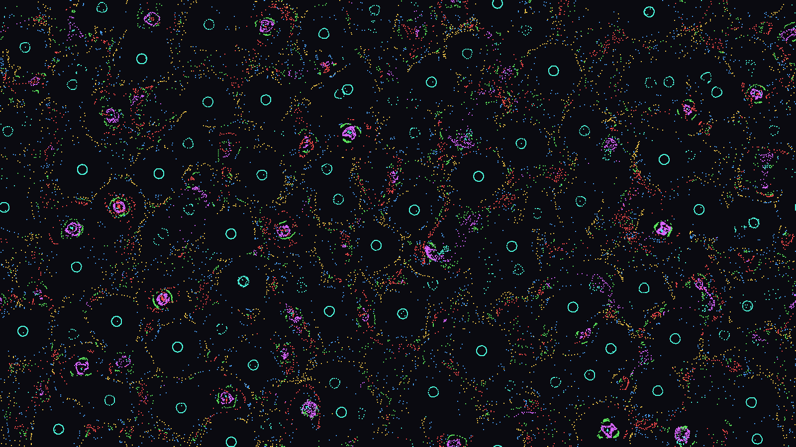

# Particle Life in x86-64 assembly

A Particle Life simulation whose whole program — simulation core, software
renderer, SDL2 window loop, argument parsing, benchmark — is hand-written
x86-64 assembly (GNU `as`, `.intel_syntax noprefix`, ~2300 lines). C appears
only in the reference implementation and the test harness.



*20 000 particles, 6 types, 1600×900, seed 1, after 6000 steps
(`--dump-frame`, converted to PNG).*

The model and parameters follow `~/code/pl-box` (`rules.rs`,
`simulation.rs`, render defaults): N particles of K types,
`attraction[i][j]` ∈ [-1, 1), per-pair `min_radius` ∈ [12, 24) and
`max_radius` ∈ [33, 70), force scale 0.3, core repulsion 0.6, friction 0.4,
dt = 1/60, toroidal world, semi-implicit Euler:

```
d >= maxr          : 0
d <  minr          : -core * (1 - d/minr)                    (hard-core repulsion)
minr <= d < maxr   : attraction * smoothstep(1 - (d-minr)/(maxr-minr))
v = v*(1 - friction*dt) + F*dt ;  p = wrap(p + v*dt)
```

pl-box's profile is the smoothstep-shaped bump, not the textbook triangle;
it is reproduced exactly (the O(N²) test reference below is a line-by-line
transcription of pl-box's loop).

## Build and run

Needs `gcc`/`as`/`ld`, libSDL2, and a CPU with AVX2 + FMA (AVX-512F is used
when CPUID and XGETBV report it).

```sh
make                 # build/particle_life and build/ref_bench
make run             # window, 20k particles, 1600x900
make run ARGS="--particles 50000 --types 9 --no-vsync"
make test            # asm vs C reference vs brute force
make bench           # headless, 10k/50k/200k particles, 1 and 8 threads
make bench-ref       # C reference, gcc -O3 -march=native
make bench-ref-clang # C reference, clang -O3 -ffast-math -march=native
```

```
particle_life [--particles N] [--types K(1-16)] [--seed S] [--width W] [--height H]
              [--threads T] [--simd avx2|avx512] [--cell-div 1|2]
              [--steps-per-frame S] [--no-vsync]
              [--bench STEPS [--warmup STEPS]]          headless benchmark
              [--dump-frame out.ppm [--steps STEPS]]    headless, writes one frame
              [--keys STR]                              feed key presses to the key handler first
```

Keys: Space pause, R new rules, N new positions, `+`/`-` particle count
×5/4 and ×4/5 (respawns), 1–9 type count (new rules and positions), Esc
quit. The title shows particles, types, fps, ms per step, threads and SIMD
path. The world is the window size, drawn 1:1. The window uses half the
logical CPUs by default; bench and dump use 1 thread unless `--threads` is
given.

## Layout

```
src/layout.inc   offsets of the global state struct `pl`
src/sim.S        RNG, rules, grid tables, binning (serial + parallel phases),
                 force kernels (AVX2 K<=8, AVX2 K<=16, AVX-512), step, CPUID
src/threads.S    pthread workers, barriers, dynamic cell scheduling
src/render.S     software renderer into an ARGB8888 buffer, PPM writer
src/main.S       main: options, bench, frame dump, SDL2 window and keys
ref/ref.c        C reference: same grid step + O(N^2) pl-box-style step
ref/pl_state.h   C view of `pl` (offsets checked by _Static_assert)
tests/test_step.c asm vs reference comparison (make test)
```

### Memory layout

One global struct `pl` (7424 bytes, 64-byte aligned, `src/layout.inc`)
holds scalars, pointers and the rule tables. Particles are
structure-of-arrays, float32 / int32, each array padded with 32 zeroed
elements so vector loads may run past the end:

```
current set  x[] y[] vx[] vy[] type[] id[]     cell-ordered
second set   x2[] y2[] vx2[] vy2[] type2[] id2[]  sort destination, swapped each step
scratch      nx[] ny[] (integrated positions), cellid[]
grid         cstart[ncells+1], ccur[ncells+1], nbr[ncells][10] neighbour ranges
tables       attr/minr/maxr[16][16]; kernel tables b0, ir, c1, as [16][16]
```

Rule tables have 16-float rows, so one type's row is one zmm register (or
two ymm) and per-pair parameters are fetched with `vpermps` indexed by the
neighbours' types. Up to 16 types are supported.

## Algorithm

Each step:

1. **Forces + integration.** Process each cell. For each particle *i* in it,
   sum the forces from every particle in the (2R+1)×(2R+1) neighbouring cells.
   Because particles are stored in cell order, the cells of one neighbour row
   form one contiguous index range (two at a wrap-around edge). Each range
   carries a ±W/±H shift that implements the torus without per-pair
   branches. The inner loop is SIMD over *j* (8 lanes AVX2, 16 lanes
   AVX-512). Then *i* is integrated, writing the velocity in place and the
   new position to `nx/ny`.
2. **Binning.** A stable counting sort by cell of `nx/ny` moves
   (x, y, vx, vy, type, id) into the second set, then the sets swap. Cell ids
   are computed 8 at a time. Counts and cursors are kept in registers for
   runs of equal cells, since particles rarely change cell. Each array then
   gets its own simple scatter loop.

Grid: cell size ≥ max radius / R, with R = `--cell-div`. With R = 1
(cell = max radius, the classic 3×3 cell list) a particle examines ~223
candidates, of which ~20% are within range. **R = 2 (default)** uses half-size
cells and a 5×5 neighbourhood: ~155 candidates, about 30% less work, and
1.2× faster in practice.

Force kernel per pair, using `s = (maxr - d)/(maxr - minr) = b0 - d·ir`:
s > 1 ⇔ d < minr and s ≤ 0 ⇔ d ≥ maxr, so no explicit cut-off mask is
needed. The kernel accumulates `g·(dx, dy)` with g = f/d:

```
core branch  (s > 1):  g = (d·c1 - core)/d = c1 - core/d
attraction   (s <= 1): g = a · sc²(3 - 2sc) / d,   sc = max(s, 0)
```

1/d is `vrsqrtps`/`vrsqrt14ps` plus one Newton step. The Newton step's ½ is
folded into the tables (exact powers of two), so the kernel works with 2/d
and 2d.

What made it fast (single thread, 10k particles, ns per particle-step):

| change | AVX-512 | AVX2 |
|---|---:|---:|
| first working version, R = 1 | 89.3 | 106.7 |
| binning: register run-lengths, per-array scatter | 85.6 | — |
| shorter dependency chain (c1 - core/d, parallel 1/d and d) | 83.8 | 96.4 |
| 2-stage software pipeline (AVX-512) | 78.5 | — |
| fewer FP-register allocations (folded loads, eps in FMA, no min) | 73.6 | 86.0 |
| R = 2 half-size cells | 62.9 | 71.2 |
| AVX-512: one pipelined stream over all ranges, masked tails | 62.1 | 71.0 |

`perf` showed the kernel bound by the FP physical register file on Zen 4,
not by FP throughput. 61% of cycles were dispatch stalls on
`fp_reg_file_rsrc_stall`: each vector of pairs has a ~55-cycle dependency
chain, and every zmm result holds a register until it retires. The changes
above shorten the chain and cut the number of register-writing ops per
vector. AVX-512 beats AVX2 here (16 lanes per register, masks, single
16-entry `vpermps` lookups), so it is the default when available. The AVX2
path stays for other CPUs and `--simd avx2`.

**Multi-threading:** persistent pthreads sleep on a pthread barrier between
steps. In a step, cells are handed out in chunks through an atomic counter
(dynamic, since clustering makes per-cell work uneven). Binning then runs
as a parallel counting sort: per-thread histograms over 16-aligned particle
chunks, a prefix sum over cell blocks, and per-chunk permutation and scatter.
It gives the same order as the serial sort. The phases are separated by a
spinning barrier that falls back to `sched_yield`.

## Correctness

`make test` builds `tests/test_step.c`, which links the asm core with
`ref/ref.c`, and runs each configuration from the same seed:

- rules, derived tables, grid, initial positions, cell order and ids must
  be **bit-identical** between asm and C;
- after every step, asm positions (matched by particle id, toroidal
  distance) must agree within **1e-3 px** with the C grid step, and on the
  smaller cases also with an **O(N²) brute-force** step written the way
  pl-box writes it (minimum-image delta, original force law). That proves
  the grid misses no neighbours.

Configurations: R = 1 and R = 2; AVX2 K≤8, AVX2 K>8 and AVX-512 kernels;
a tiny world with wrap-around on every cell; strong forces (dt = 1/20, force
scale 3, ~0.8 px/step, crossing cells and edges); a very dense world with
neighbour ranges far longer than 256 particles. That case caught a real
lane-mask bug (`bzhi` only reads 8 index bits), which I fixed and checked by
re-breaking the code. The test also covers 30k particles at 1920×1080 with 1
and 8 threads on both kernels, and 100 particles on 8 threads, where most
parallel-bin chunks are empty.

Last run (excerpt):

```
--- cell size = max radius / 1
N=2000   K=6  world= 800x600  fscale=0.3 dt=0.017 avx2-k8  threads=1  R=1 grid=11x8  init bit-identical
  60 steps: max |asm - C grid| = 6.10e-05 px, max |asm - brute| = 7.63e-06 px, max speed 0.022 px/step  OK
N=2000   K=11 world= 600x400  fscale=3.0 dt=0.050 avx512   threads=1  R=1 grid=8x5  init bit-identical
  20 steps: max |asm - C grid| = 6.10e-05 px, max |asm - brute| = 6.10e-05 px, max speed 0.827 px/step  OK
N=12000  K=4  world= 256x256  fscale=0.3 dt=0.017 avx512   threads=1  R=1 grid=3x3  init bit-identical
  3 steps: max |asm - C grid| = 1.93e-04 px, max |asm - brute| = 1.53e-05 px, max speed 0.012 px/step  OK
--- cell size = max radius / 2
N=30000  K=9  world=1920x1080 fscale=0.3 dt=0.017 avx2-k16 threads=8  R=2 grid=55x31  init bit-identical
  30 steps: max |asm - C grid| = 6.10e-05 px, max speed 0.028 px/step  OK
ALL TESTS PASSED
```

The residual differences are a few float ulps. They come from summation
order and the rsqrt + Newton 1/d versus the C `1/sqrtf`. pl-box's force law
has a jump at d = minr, so the C grid and asm can disagree by up to ~5e-4 px
over 30 steps when a pair sits exactly on minr.

## Performance

AMD Ryzen 7 255 (Zen 4, 8 cores / 16 threads, mobile), Linux, gcc 16.2,
clang 22.1. Constant density (10k particles per 1920×1080, the world grows
with N), 6 types, seed 1, 100 warm-up steps then 200 timed steps
(`make bench`). The machine was shared with other sessions (load average
≈3), so multi-thread numbers are noisy.

| particles | world | asm 1 thread | ns/particle-step | asm 8 threads | ns/particle-step |
|---:|---|---:|---:|---:|---:|
| 10 000 | 1920×1080 | 1610 steps/s | 62.1 | 10 636 steps/s | 9.4 |
| 50 000 | 4293×2415 | 325 steps/s | 61.6 | 1 893 steps/s | 10.6 |
| 200 000 | 8587×4830 | 79.7 steps/s | 62.8 | 496 steps/s | 10.1 |

C reference (`ref/ref.c`, same algorithm and R = 2, scalar code, one
thread):

| particles | gcc -O3 -march=native | clang -O3 -ffast-math -march=native | asm 1 thread vs gcc | vs clang |
|---:|---:|---:|---:|---:|
| 10 000 | 143 steps/s (697 ns) | 416 steps/s (241 ns) | 11.2× | 3.9× |
| 50 000 | 28.7 steps/s (697 ns) | 82.0 steps/s (244 ns) | 11.3× | 3.9× |
| 200 000 | 7.2 steps/s (691 ns) | 19.9 steps/s (252 ns) | 11.1× | 4.0× |

GCC does not vectorise the reference's inner loop: per-pair table lookups
and the branch select read as "unsupported control flow". Clang does
(16-wide AVX-512) once `-ffast-math` lets it reassociate the force sums. The
clang column is the fair "good compiler" baseline.

Other single-thread variants (ns/particle-step at 10k / 50k / 200k):

| variant | 10k | 50k | 200k |
|---|---:|---:|---:|
| AVX-512, R = 2 (default) | 62.1 | 61.6 | 62.8 |
| AVX2, R = 2 | 71.0 | 74.1 | 74.6 |
| AVX-512, R = 1 (cell = max radius) | 74.3 | 74.2 | 74.5 |
| AVX2, R = 1 | 85.1 | 83.5 | 83.9 |

Thread scaling at 200k (one run each, shared machine): 1 → 79.5,
4 → 291, 8 → 447–511, 12 → 564, 16 → 340 steps/s. 16 threads use every
logical CPU, so other processes preempt the spinning phases. SMT siblings
also share the FP units this kernel saturates.

Window (Wayland/niri, run for a few seconds with `timeout`, read back via
`niri msg windows`): 20 000 particles in 1600×900, 8 threads, AVX-512: title
"120 fps | step 0.79 ms" with vsync. 50 000 particles with `--no-vsync`:
"159 fps | step 2.62 ms" at 2 steps per frame.

## What was tested and what not

- `make test` passes (output above). `make bench` and the reference benches
  were run, giving the numbers above.
- The SDL window opened on this Wayland session (niri, native Wayland) and
  ran for 6–10 s with no errors, and the compositor reported the title with
  live fps. I did not look at the window contents. The visual check is the
  `--dump-frame` output, which goes through the same `pl_render` code.
- Key presses were not sent to the real window, to avoid injecting input
  into the desktop. The key handler is the same function `--keys` drives
  headlessly. `+`, `-`, `1`–`9`, `r` and `n` were exercised that way
  (counts and frames change as expected). Space and Esc are only reachable
  from the window.

## Not done / limitations

- Only random rules (pl-box's Random preset), uniform random spawn, wrap
  boundary. No presets, spawn patterns, brush or mutation drift.
- The world is the window size, drawn 1:1. There is no zoom/pan and the
  window does not resize.
- `+`/`-` and `1`–`9` respawn all particles rather than adding or removing
  some.
- No Newton's-third-law pair sharing: each pair is evaluated from both
  sides (like pl-box), which doubles the arithmetic but avoids write
  conflicts.
- AVX-512 always keeps the Newton step on `rsqrt14`. Dropping it (14-bit
  1/d) would cut more register pressure but was left out for accuracy.
- Up to 16 types (one zmm table row). Keys only reach 9.
- Binning is serial when running single-threaded (~7% of the step).
- Linux x86-64 only (SysV ABI, glibc, PIE).
